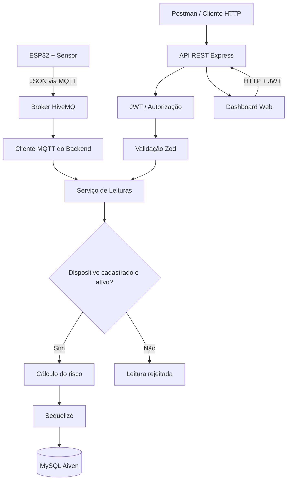

# FloodGuard

Sistema de monitoramento de níveis de água para apoio à identificação de riscos de enchentes, desenvolvido como projeto acadêmico do SENAI.

O FloodGuard recebe leituras de dispositivos IoT, processa os dados por MQTT ou pela API REST, valida as informações, calcula automaticamente o nível de risco e armazena os dados em um banco MySQL hospedado na Aiven.

A aplicação possui autenticação JWT, controle de permissões, dashboard web responsivo, histórico de leituras, indicadores de risco, gráficos, alertas, mapa de localização da estação e integração com ESP32.

> **Importante:** o FloodGuard é um protótipo acadêmico de pequena escala. Os limites utilizados no projeto servem para demonstração e não representam parâmetros oficiais para enchentes reais.

---

## Sumário

- [Objetivo](#objetivo)
- [Funcionalidades](#funcionalidades)
- [Tecnologias](#tecnologias)
- [Arquitetura](#arquitetura)
- [Estrutura do projeto](#estrutura-do-projeto)
- [Modelo de dados](#modelo-de-dados)
- [Regras de negócio](#regras-de-negócio)
- [Instalação e execução](#instalação-e-execução)
- [Banco de dados Aiven](#banco-de-dados-aiven)
- [Migrations](#migrations)
- [Autenticação e permissões](#autenticação-e-permissões)
- [API REST](#api-rest)
- [MQTT](#mqtt)
- [ESP32 e IoT](#esp32-e-iot)
- [Dashboard](#dashboard)
- [Mapa e geolocalização](#mapa-e-geolocalização)
- [Validação com Zod](#validação-com-zod)
- [Histórico e análises](#histórico-e-análises)
- [Alertas](#alertas)
- [Testes e validações](#testes-e-validações)
- [Segurança](#segurança)
- [Limitações](#limitações)
- [Próximas evoluções](#próximas-evoluções)

---

## Objetivo

O objetivo do FloodGuard é demonstrar uma solução IoT capaz de monitorar o nível da água em uma estação, transmitir as informações para um backend e apresentar o risco de forma visual.

O sistema foi estruturado para separar as responsabilidades entre:

1. Dispositivo de monitoramento.
2. Comunicação MQTT.
3. Backend/API REST.
4. Validação e regras de negócio.
5. Banco de dados.
6. Dashboard web.

---

## Funcionalidades

### Monitoramento

- Recebimento de leituras do nível da água.
- Integração com ESP32.
- Comunicação por MQTT.
- Recebimento de leituras também pela API REST.
- Registro de distância e altura da água.
- Registro de tendência da água.
- Registro de data e hora da leitura.

### Processamento

- Validação dos dados recebidos.
- Verificação de dispositivo cadastrado.
- Verificação de dispositivo ativo.
- Cálculo do status de risco no backend.
- Persistência das leituras no MySQL.
- Controle de erros no processamento MQTT.

### Usuários

- Cadastro de usuários.
- Login.
- Senhas protegidas com `bcryptjs`.
- Autenticação por JWT.
- Perfis `ADMIN` e `OPERADOR`.
- Controle de permissões.

### Dispositivos

- Cadastro de dispositivos.
- Consulta de dispositivos.
- Atualização de dispositivos.
- Exclusão de dispositivos.
- Ativação e desativação.
- Armazenamento de latitude e longitude.
- Restrição das operações administrativas ao perfil `ADMIN`.

### Dashboard

- Visão geral da estação.
- Nível atual da água.
- Status atual de risco.
- Tendência da água.
- Indicador de tempo crítico.
- Flood Risk Score.
- Gráficos de nível.
- Histórico de leituras.
- Filtros de período.
- Estatísticas de máximo, mínimo, média e quantidade de leituras.
- Previsão baseada no comportamento recente.
- Velocidade de variação do nível.
- Eventos recentes.
- Alertas.
- Lista de estações em risco.
- Mapa da estação monitorada.
- Atualização periódica dos dados.
- Menu de perfil e logout.

---

## Tecnologias

### Backend

- Node.js
- Express
- Sequelize ORM
- MySQL
- `mysql2`
- `sequelize-cli`
- Migrations
- Zod
- MQTT.js
- JSON Web Token (`jsonwebtoken`)
- `bcryptjs`
- `dotenv`

### Frontend

- HTML5
- CSS3
- JavaScript
- Leaflet
- Font Awesome
- SVG para gráficos do dashboard

### IoT

- ESP32
- Sensor ultrassônico
- MQTT
- Broker público HiveMQ

### Banco de dados

- MySQL hospedado na Aiven
- Conexão SSL com certificado CA

---

## Arquitetura



O backend concentra as regras de negócio.

As leituras podem chegar por dois caminhos:

- MQTT, utilizado principalmente para a comunicação com o dispositivo IoT.
- HTTP, utilizado pela API REST e por ferramentas como Postman.

Em ambos os casos, o sistema verifica o dispositivo e processa a leitura antes de armazená-la.

---

## Estrutura do projeto

```text
floodguard/
├── config/
│   ├── config.json
│   ├── config.aiven.json
│   └── config.aiven.js
│
├── migrations/
│   ├── 20261016202012-initial-schema.js
│   ├── 20261109000100-add-distancia-leituras.js
│   └── 20261109000200-add-coordenadas-dispositivos.js
│
├── scripts/
│   └── migrar-sqlite-para-aiven.js
│
├── public/
│   ├── index.html
│   ├── css/
│   │   └── style.css
│   └── js/
│       └── dashboard.js
│
├── src/
│   ├── config/
│   │   └── database.js
│   │
│   ├── controllers/
│   │   ├── AuthController.js
│   │   ├── DispositivoController.js
│   │   └── LeituraController.js
│   │
│   ├── middlewares/
│   │   ├── authMiddleware.js
│   │   ├── autorizacaoMiddleware.js
│   │   └── validarSchema.js
│   │
│   ├── models/
│   │   ├── Dispositivo.js
│   │   ├── Leitura.js
│   │   └── Usuario.js
│   │
│   ├── mqtt/
│   │   └── mqttClient.js
│   │
│   ├── routes/
│   │   ├── authRoutes.js
│   │   ├── dispositivoRoutes.js
│   │   └── leituraRoutes.js
│   │
│   ├── schemas/
│   │   └── leituraSchema.js
│   │
│   ├── services/
│   │   ├── leituraService.js
│   │   ├── riscoService.js
│   │   └── riscoService.test.js
│   │
│   └── server.js
│
├── ca.pem
├── .env
├── .gitignore
├── package.json
├── package-lock.json
└── README.md
```

> O arquivo `.env` e o certificado `ca.pem` devem ser protegidos e não devem ser publicados em repositórios públicos.

---

## Modelo de dados

### Usuario

| Campo | Descrição |
|---|---|
| `id` | Identificador |
| `nome` | Nome do usuário |
| `email` | E-mail único |
| `senha` | Senha armazenada como hash |
| `perfil` | `ADMIN` ou `OPERADOR` |

### Dispositivo

| Campo | Descrição |
|---|---|
| `id` | Identificador interno |
| `device_id` | Identificador externo usado pelo IoT |
| `nome` | Nome da estação |
| `localizacao` | Descrição do local |
| `latitude` | Latitude da estação |
| `longitude` | Longitude da estação |
| `ativo` | Indica se o dispositivo pode registrar leituras |

As coordenadas foram adicionadas posteriormente ao modelo para permitir a representação da estação no mapa do dashboard.

### Leitura

| Campo | Descrição |
|---|---|
| `id` | Identificador da leitura |
| `distancia` | Distância medida pelo sensor, em centímetros |
| `altura` | Altura da água, em centímetros no dashboard |
| `tendencia` | `subindo`, `estavel` ou `descendo` |
| `data` | Data e hora da leitura |
| `status` | Classificação de risco |
| `dispositivo_id` | Dispositivo associado |

Uma estação pode possuir várias leituras.

---

## Regras de negócio

### Validação

Uma leitura precisa possuir:

- `device_id`
- `distancia`
- `altura`
- `tendencia`
- `data`

A distância e a altura precisam ser numéricas e não negativas.

A tendência deve ser uma das opções:

```text
subindo
estavel
descendo
```

A data deve estar no formato ISO 8601 com informação de fuso horário.

### Dispositivo

Antes de salvar uma leitura, o backend verifica:

1. Se o `device_id` existe.
2. Se o dispositivo está ativo.
3. Se os dados da leitura são válidos.

Leituras de dispositivos inexistentes ou inativos são rejeitadas.

### Classificação de risco

O FloodGuard utiliza atualmente os seguintes limites para o protótipo:

| Nível da água | Status |
|---:|---|
| `< 5 cm` | Normal |
| `5 cm a < 10 cm` | Atenção |
| `10 cm a < 15 cm` | Alerta |
| `>= 15 cm` | Evacuação |

O limite crítico utilizado pelo dashboard é:

```text
15 cm
```

O status é calculado pelo backend, e não depende do valor de `status` enviado pelo dispositivo.

> Esses valores são específicos do protótipo de pequena escala e não devem ser utilizados como parâmetros de segurança para uma enchente real.

---

## Instalação e execução

### Pré-requisitos

- Node.js
- npm
- MySQL acessível
- Conta/banco na Aiven
- Certificado CA do MySQL
- Acesso à internet para o broker MQTT e bibliotecas externas

### Instalar dependências

```bash
npm install
```

### Configurar o `.env`

Crie o arquivo `.env` na raiz:

```env
DB_HOST=seu_host_mysql
DB_PORT=sua_porta_mysql
DB_NAME=seu_banco
DB_USER=seu_usuario
DB_PASSWORD=sua_senha
JWT_SECRET=sua_chave_secreta
```

### Executar migrations

Verificar o status:

```bash
npm run db:migrate:status
```

Executar:

```bash
npm run db:migrate
```

### Iniciar em desenvolvimento

```bash
npm run dev
```

### Iniciar normalmente

```bash
npm start
```

O servidor utiliza a porta:

```text
3000
```

Dashboard:

```text
http://localhost:3000/
```

---

## Banco de dados Aiven

O FloodGuard foi originalmente estruturado utilizando SQLite local e posteriormente migrado para MySQL hospedado na Aiven.

A aplicação utiliza:

- MySQL.
- `mysql2`.
- Sequelize.
- SSL.
- Certificado CA.
- `rejectUnauthorized: true`.
- Variáveis de ambiente para as credenciais.

A conexão principal da aplicação está em:

```text
src/config/database.js
```

A configuração utilizada pelo Sequelize CLI para migrations está em:

```text
config/config.aiven.js
```

### Migração SQLite → Aiven

O projeto possui o script:

```text
scripts/migrar-sqlite-para-aiven.js
```

Ele foi utilizado para transferir os dados da base SQLite original para o MySQL da Aiven.

Na migração realizada anteriormente foram transferidos:

- 3 dispositivos.
- 4 usuários.
- 155 leituras.

Os identificadores e hashes existentes foram preservados.

> Não execute novamente o script de migração sem verificar o estado atual do banco.

---

## Migrations

Além do schema inicial, foram adicionadas migrations para evoluir o banco durante o desenvolvimento.

### Schema inicial

```text
20261016202012-initial-schema.js
```

### Distância da leitura

```text
20261109000100-add-distancia-leituras.js
```

Adicionou o campo `distancia` ao modelo de leituras.

### Coordenadas dos dispositivos

```text
20261109000200-add-coordenadas-dispositivos.js
```

Adicionou:

```text
latitude
longitude
```

ao modelo de dispositivos.

Essas coordenadas passaram a ser utilizadas pelo mapa do dashboard.

---

## Autenticação e permissões

O login utiliza JWT.

O token deve ser enviado nas rotas protegidas:

```http
Authorization: Bearer SEU_TOKEN
```

### Perfis

| Ação | Público | OPERADOR | ADMIN |
|---|---:|---:|---:|
| Cadastro de usuário | Sim | Não | Não |
| Login | Sim | Sim | Sim |
| Consultar dispositivos | Não | Sim | Sim |
| Criar dispositivo | Não | Não | Sim |
| Atualizar dispositivo | Não | Não | Sim |
| Excluir dispositivo | Não | Não | Sim |
| Consultar leituras | Não | Sim | Sim |
| Registrar leitura | Não | Sim | Sim |

O perfil `OPERADOR` possui acesso de consulta, enquanto as operações administrativas sobre dispositivos ficam restritas ao `ADMIN`.

---

## API REST

Base local:

```text
http://localhost:3000
```

### Autenticação

| Método | Endpoint | Acesso | Descrição |
|---|---|---|---|
| `POST` | `/auth/cadastro` | Público | Cadastro de usuário |
| `POST` | `/auth/login` | Público | Login e obtenção do JWT |

### Dispositivos

| Método | Endpoint | Acesso |
|---|---|---|
| `GET` | `/dispositivos` | Autenticado |
| `GET` | `/dispositivos/:id` | Autenticado |
| `POST` | `/dispositivos` | ADMIN |
| `PUT` | `/dispositivos/:id` | ADMIN |
| `DELETE` | `/dispositivos/:id` | ADMIN |

### Leituras

| Método | Endpoint | Acesso |
|---|---|---|
| `GET` | `/leituras` | Autenticado |
| `POST` | `/leituras` | ADMIN ou OPERADOR |

Exemplo:

```json
{
  "device_id": "ESP32-001",
  "distancia": 10.5,
  "altura": 16.2,
  "tendencia": "subindo",
  "data": "2026-11-10T12:00:00-03:00"
}
```

O status de risco não precisa ser enviado pelo cliente, pois é calculado pelo backend.

---

## MQTT

### Configuração

```text
Broker: broker.hivemq.com
Porta: 1883
Protocolo: MQTT
Tópico: floodguard/leituras
```

### Exemplo de mensagem

```json
{
  "device_id": "ESP32-001",
  "distancia": 10.5,
  "altura": 16.2,
  "tendencia": "subindo",
  "data": "2026-11-10T12:00:00-03:00"
}
```

### Fluxo

1. O ESP32 realiza a medição.
2. O dispositivo publica um JSON no MQTT.
3. O broker HiveMQ recebe a mensagem.
4. O cliente MQTT do backend recebe a mensagem.
5. O backend interpreta o JSON.
6. O serviço valida os dados.
7. O dispositivo é verificado.
8. O status de risco é calculado.
9. A leitura é armazenada no MySQL da Aiven.
10. O dashboard consulta os dados atualizados.

O cliente MQTT está em:

```text
src/mqtt/mqttClient.js
```

O broker utilizado é público e destinado à demonstração.

---

## ESP32 e IoT

O protótipo possui integração com ESP32 para realizar as medições.

O fluxo do dispositivo é:

```text
Sensor ultrassônico
        ↓
ESP32
        ↓
Cálculo da distância
        ↓
Cálculo da altura
        ↓
Determinação da tendência
        ↓
JSON
        ↓
MQTT
        ↓
FloodGuard Backend
```

O backend permanece como responsável pela classificação oficial do risco.

Isso evita que o dispositivo consiga definir sozinho um status diferente das regras do sistema.

---

## Dashboard

O dashboard está localizado em:

```text
public/index.html
public/css/style.css
public/js/dashboard.js
```

### Visão geral

A tela principal apresenta:

- Nível atual.
- Status de risco.
- Tendência.
- Tempo estimado até condição crítica.
- Flood Risk Score.
- Gráfico do nível da água.
- Previsão.
- Velocidade de variação.
- Tempo em cada nível.
- Eventos recentes.
- Leituras recentes.
- Mapa da estação.

### Atualização

O dashboard realiza atualização periódica dos dados para apresentar novas leituras sem necessidade de recarregar manualmente a página.

### Histórico

O histórico possui filtros por período, incluindo:

- 15 minutos.
- 1 hora.
- 6 horas.
- 24 horas.
- Dias.
- Histórico total.

A tabela apresenta:

- Data.
- Hora.
- Dispositivo.
- Distância.
- Altura.
- Tendência.
- Status.

### Gráfico

O gráfico apresenta:

- Evolução do nível da água.
- Linha de Atenção.
- Linha de Alerta.
- Linha de Evacuação.
- Horário das leituras.

Ao passar o mouse sobre um ponto do gráfico, são exibidas informações detalhadas da leitura, incluindo:

- Data.
- Hora.
- Nível.
- Distância.
- Tendência.
- Status.

---

## Mapa e geolocalização

O dashboard utiliza Leaflet para apresentar a localização da estação.

Os dispositivos possuem:

```text
latitude
longitude
```

O mapa utiliza as coordenadas cadastradas no dispositivo.

A estação atualmente utilizada no protótipo é:

```text
ESP32-001
SENAI Lauro de Freitas/BA
```

O mapa apresenta:

- Marcador da estação.
- Área visual de referência.
- Status da leitura.
- Nível atual.
- Identificação da estação.

As coordenadas são dados de configuração do protótipo e não representam uma infraestrutura de geolocalização em tempo real.

---

## Validação com Zod

O Zod é utilizado na validação das requisições HTTP de cadastro de leituras.

Arquivos relacionados:

```text
src/schemas/leituraSchema.js
src/middlewares/validarSchema.js
src/routes/leituraRoutes.js
```

O schema valida:

- `device_id`.
- `distancia`.
- `altura`.
- `tendencia`.
- `data`.

A data deve utilizar ISO 8601 com fuso horário.

Exemplo válido:

```text
2026-11-10T12:00:00-03:00
```

Quando os dados são inválidos, a API retorna:

```text
400 Bad Request
```

O Zod é utilizado na entrada HTTP. O processamento MQTT possui suas próprias verificações no serviço de leituras.

Além do Zod, o serviço de leituras realiza validações de negócio antes da persistência.

---

## Histórico e análises

O dashboard calcula informações a partir das leituras armazenadas.

Entre os indicadores disponíveis estão:

- Maior nível registrado.
- Menor nível registrado.
- Nível médio.
- Quantidade de leituras.
- Velocidade de variação.
- Tendência.
- Tempo em cada faixa de risco.
- Projeção do comportamento recente.
- Tempo estimado até o nível crítico.

Os gráficos são atualizados conforme o período selecionado.

---

## Alertas

A página de alertas identifica as estações que apresentam:

```text
ALERTA
ou
EVACUAÇÃO
```

Quando nenhuma estação está nessas condições, o sistema apresenta uma mensagem indicando que não existem alertas críticos.

Quando existem estações em risco, o dashboard apresenta:

- Quantidade de estações em risco.
- Nome da estação.
- `device_id`.
- Nível atual.
- Horário da leitura.
- Status de risco.

A classificação é baseada na leitura mais recente de cada dispositivo.

---

## Testes e validações

Foram realizados testes envolvendo:

### API

- Cadastro de usuário.
- Login.
- Autenticação JWT.
- Acesso sem token.
- Consulta de dispositivos.
- Controle de permissões.
- Cadastro de leituras.
- Validação de dados inválidos.
- Dispositivo inexistente.
- Dispositivo inativo.

### Zod

Foram testados cenários como:

| Cenário | Resultado esperado |
|---|---|
| `device_id` vazio | `400 Bad Request` |
| Distância/altura negativa | Rejeição |
| Data inválida | `400 Bad Request` |
| Dispositivo inexistente | `404 Not Found` |
| Leitura válida | `201 Created` |

### MQTT

- Conexão com o broker.
- Inscrição no tópico.
- Recebimento de mensagens.
- Conversão do JSON.
- Processamento da leitura.
- Persistência no banco.
- Rejeição de mensagens inválidas.

### Dashboard

- Login.
- Logout.
- Atualização das leituras.
- Atualização dos indicadores.
- Gráficos.
- Histórico.
- Filtros.
- Alertas.
- Lista de estações.
- Mapa.
- Localização do dispositivo.
- Controle de visualização por perfil.

O serviço de classificação possui teste em:

```text
src/services/riscoService.test.js
```

---

## Segurança

O projeto possui algumas medidas de segurança:

- Senhas armazenadas com hash.
- Autenticação por JWT.
- Controle de permissões.
- Validação de entrada com Zod.
- Verificação de dispositivo ativo.
- Credenciais armazenadas em variáveis de ambiente.
- Conexão MySQL com SSL.
- Validação do certificado CA.
- `rejectUnauthorized: true`.

### Informações sensíveis

Nunca publique:

```text
.env
ca.pem
senhas
JWT_SECRET
credenciais da Aiven
tokens JWT
```

---

## Limitações

O FloodGuard é um protótipo acadêmico e possui limitações.

- O broker MQTT utilizado é público.
- A comunicação MQTT atual utiliza a porta 1883 sem TLS.
- Os limites de risco são específicos do protótipo.
- O sensor e o recipiente representam uma pequena escala.
- O mapa apresenta uma localização cadastrada, não rastreamento GPS em tempo real.
- As previsões são baseadas nas leituras disponíveis e não substituem modelos hidrológicos.
- Uma aplicação real exigiria redundância, monitoramento, autenticação MQTT, TLS, alta disponibilidade e infraestrutura adequada.
- Os alertas não devem ser utilizados como único mecanismo para decisões reais de evacuação.

---

## Próximas evoluções

Possíveis evoluções do projeto:

- Comunicação MQTT com TLS.
- Autenticação no broker MQTT.
- Notificações em tempo real.
- Integração com sensores adicionais.
- Mais estações de monitoramento.
- Histórico comparativo entre estações.
- Sistema de notificações por e-mail ou aplicativo.
- Persistência de eventos de alerta.
- Modelos de previsão mais avançados.
- Integração com dados meteorológicos.
- Dashboard público para órgãos responsáveis.
- Monitoramento de disponibilidade dos dispositivos.
- Deploy em ambiente de produção.

---

## Status do projeto

O FloodGuard possui atualmente integração entre:

```text
ESP32
  ↓
Sensor
  ↓
MQTT / HiveMQ
  ↓
Backend Node.js + Express
  ↓
Validação + Regras de negócio
  ↓
Sequelize
  ↓
MySQL / Aiven
  ↓
API REST
  ↓
Dashboard Web
```

O sistema conta com autenticação, permissões, validação com Zod, classificação automática de risco, armazenamento das leituras, histórico, análises, alertas e mapa da estação.

---

**Projeto:** FloodGuard  
**Finalidade:** monitoramento demonstrativo de níveis de água e classificação de risco de enchentes.  
**Contexto:** projeto acadêmico SENAI.
