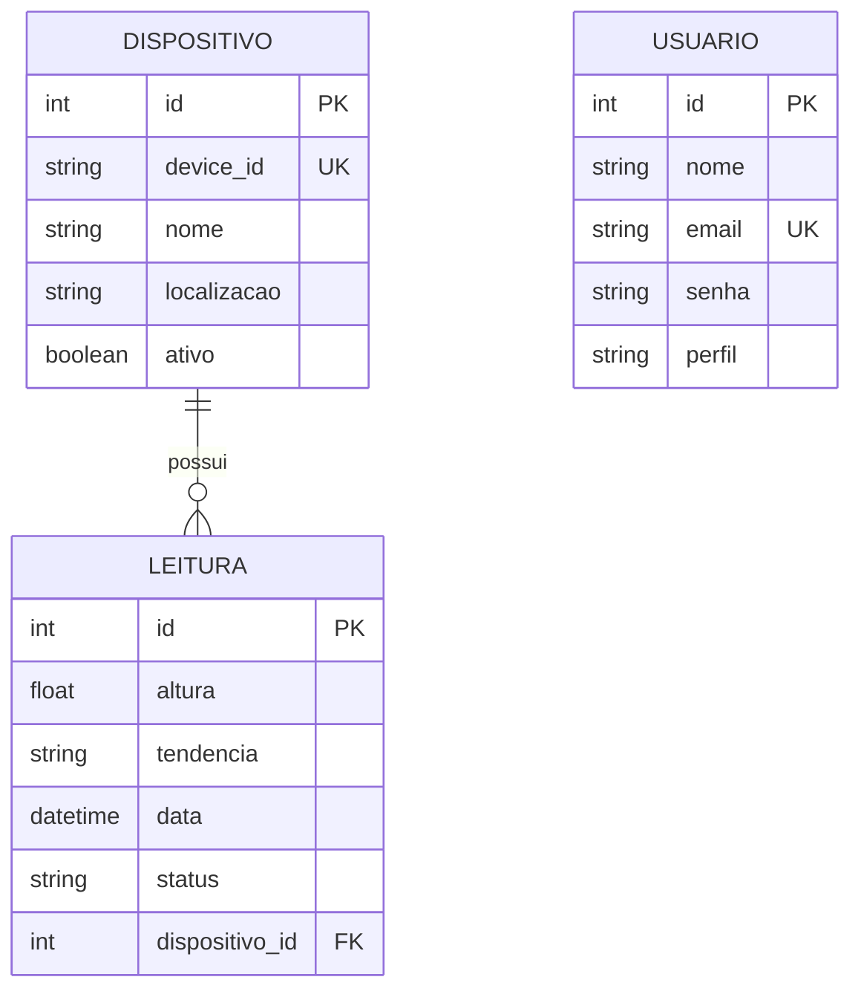

# FloodGuard - Diagrama do Banco de Dados

## Diagrama de entidades e relacionamentos

## Descrição das entidades

### Usuario
- `id`: chave primária.
- `nome`: nome do usuário.
- `email`: e-mail único.
- `senha`: senha armazenada com hash.
- `perfil`: perfil de acesso, ADMIN ou OPERADOR.

### Dispositivo
- `id`: chave primária.
- `device_id`: identificador único do dispositivo.
- `nome`: nome da estação.
- `localizacao`: localização da estação.
- `ativo`: indica se o dispositivo está ativo.

### Leitura
- `id`: chave primária.
- `altura`: altura da água em metros.
- `tendencia`: subindo, estavel ou descendo.
- `data`: data e hora da leitura.
- `status`: classificação do risco.
- `dispositivo_id`: chave estrangeira para Dispositivo.

## Relacionamentos

Um dispositivo pode possuir várias leituras. Cada leitura pode estar vinculada a um dispositivo por meio da chave estrangeira `dispositivo_id`.

A entidade Usuario armazena as informações de autenticação e o perfil que determina as permissões de acesso.